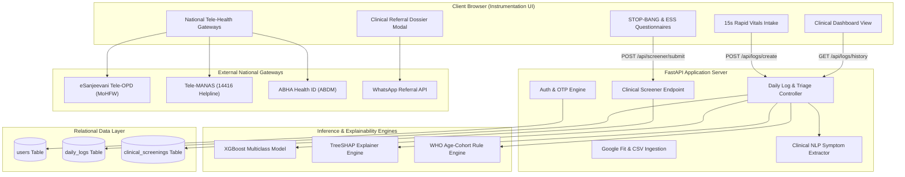
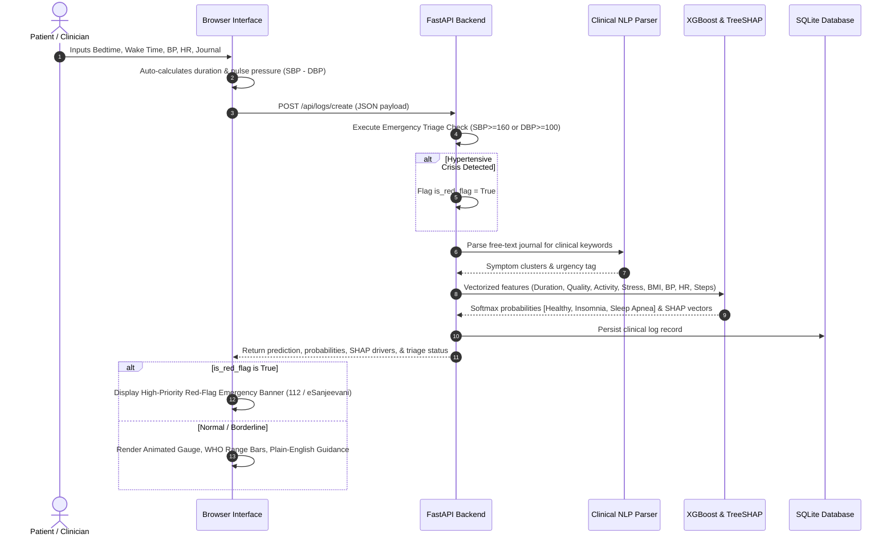
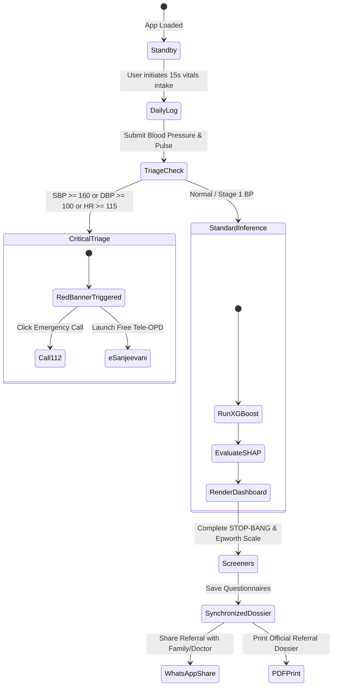
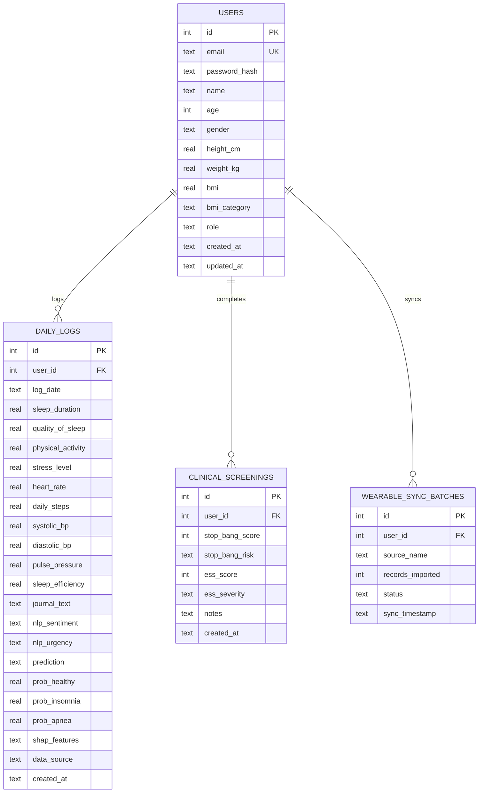

# SomnoSense: Clinical Decision Support & Sleep Architecture Platform
## Comprehensive Technical & Clinical Project Documentation

---

### Executive Summary

**SomnoSense** is an Explainable AI (XAI) Clinical Decision Support System (CDSS) designed to stratify sleep disorders—principally **Insomnia** and **Obstructive Sleep Apnea (OSA)**—while actively monitoring autonomic cardiovascular strain. Unlike consumer-grade sleep trackers that deliver opaque "sleep scores" without medical context, SomnoSense operates on clinical physiology principles:

1. **Multivariate Machine Learning Risk Stratification**: Utilizes an optimized XGBoost multiclass model to compute risk probabilities across Healthy, Insomnia, and Sleep Apnea cohorts.
2. **Game-Theoretic Explainability (TreeSHAP)**: Provides transparent biometric attribution (Shapley values) for each diagnostic prediction, ensuring clinicians understand the exact mathematical drivers behind the risk assessment.
3. **Cardiovascular Autonomic Coupling**: Evaluates arterial compliance and nocturnal sympathetic tone through real-time **Pulse Pressure ($\text{PP} = \text{SBP} - \text{DBP}$)** and resting heart rate monitoring.
4. **Standardized Clinical Questionnaires**: Incorporates standard sleep medicine instruments (**STOP-BANG** for OSA risk and the **Epworth Sleepiness Scale** for daytime hypersomnolence).
5. **Real-World Patient Care Gateways**: Connects users directly to national tele-health infrastructure (eSanjeevani Free Tele-OPD, Tele-MANAS 24x7 14416 helpline, ABHA Digital Health Account) and provides 1-click clinical summary sharing via WhatsApp and printable referral dossiers.

---

### Table of Contents
1. [Clinical & Physiological Foundations](#1-clinical--physiological-foundations)
2. [End-to-End System Architecture](#2-end-to-end-system-architecture)
3. [System Architecture & Data Flow (Mermaid Diagrams)](#3-system-architecture--data-flow-mermaid-diagrams)
4. [Machine Learning & Explainable AI (TreeSHAP) Engine](#4-machine-learning--explainable-ai-treeshap-engine)
5. [Database Architecture & Entity Relationships](#5-database-architecture--entity-relationships)
6. [Real-World Clinical & Tele-Health Gateways](#6-real-world-clinical--tele-health-gateways)
7. [User Experience & Instrumentation Interface Design](#7-user-experience--instrumentation-interface-design)
8. [Verification, Testing & Triage Edge Cases](#8-verification-testing--triage-edge-cases)
9. [Future Roadmap & Standards Compliance](#9-future-roadmap--standards-compliance)

---

### 1. Clinical & Physiological Foundations

#### 1.1 The Sleep-Cardiovascular Axis
Sleep is not merely a period of inactivity; it is an active state of cardiovascular regulation. Under normal physiological conditions (non-REM sleep), autonomic tone shifts toward parasympathetic dominance, resulting in nocturnal blood pressure "dipping" (a 10–20% decline in nocturnal arterial pressure) and decreased heart rate.

In sleep disorders, this restorative process fails:
* **Insomnia**: Characterized by persistent autonomic hyperarousal, sustained nocturnal tachycardia, and non-dipping blood pressure profiles.
* **Obstructive Sleep Apnea (OSA)**: Recurrent upper airway collapse causes nocturnal hypoxemia, acute hypercapnia, and dramatic surges in nocturnal sympathetic activity, driving morning hypertension, elevated arterial pulse pressure, and vascular remodeling.

#### 1.2 Pulse Pressure as a Vascular Biomarker
While conventional apps record only systolic and diastolic pressure, SomnoSense calculates:
$$\text{Pulse Pressure (PP)} = \text{Systolic BP} - \text{Diastolic BP}$$

A resting pulse pressure exceeding **50 mmHg** serves as an early indicator of arterial stiffness and increased left ventricular stroke work, strongly correlating with severe sleep-disordered breathing.

#### 1.3 World Health Organization (WHO) Age-Calibrated Standards
Sleep requirements vary across the human lifespan. SomnoSense implements dynamic biometric calibration according to WHO and National Sleep Foundation cohorts:

| Cohort Name | Age Range | Target Sleep Duration | Physiological Tolerance | Maximum Pulse Pressure Target |
| :--- | :--- | :--- | :--- | :--- |
| **Young Adult** | 18 – 25 years | 7.0 – 9.0 hrs | 6.0 – 11.0 hrs | 45 mmHg |
| **Adult** | 26 – 64 years | 7.0 – 9.0 hrs | 6.0 – 10.0 hrs | 50 mmHg |
| **Older Adult** | $\ge 65$ years | 7.0 – 8.0 hrs | 5.0 – 9.0 hrs | 55 mmHg |

#### 1.4 Clinical Emergency Triage Thresholds
To safeguard patient welfare, SomnoSense implements acute cardiovascular triage rules:
* **Severe Hypertensive Crisis**: Systolic BP $\ge 160\text{ mmHg}$ or Diastolic BP $\ge 100\text{ mmHg}$ triggers an immediate high-priority red alert banner with 1-click calls to emergency medical services (**112**) and government tele-consultation.
* **Arrhythmia Warning**: Resting HR $\ge 115\text{ bpm}$ (tachycardia) or $\le 45\text{ bpm}$ (bradycardia) triggers an acute clinical warning.

---

### 2. End-to-End System Architecture

SomnoSense follows a decoupled, modular clinical decision support architecture:

```
┌────────────────────────────────────────────────────────────────────────┐
│                   PRESENTATION & INSTRUMENTATION LAYER                 │
│  - Vanilla CSS Clinical Design System (Dark/Light High-Contrast)       │
│  - Interactive Circular Confidence Gauge & WHO Range Trackers          │
│  - STOP-BANG & ESS Standardized Screeners                              │
│  - 1-Click WhatsApp Referral Generator & Print-Ready PDF Dossier       │
└────────────────────────────────────┬───────────────────────────────────┘
                                     │ RESTful JSON / CORS
                                     ▼
┌────────────────────────────────────────────────────────────────────────┐
│                      APPLICATION & API CONTROLLER                      │
│  - FastAPI Daemon with Asynchronous Request Handling                   │
│  - Pydantic Validation Schemas & Gmail Domain-Lock Constraints         │
│  - Clinical NLP Screener (Heuristic Symptom Cluster Parser)            │
│  - Emergency Triage Rule Engine                                        │
└──────────────────┬─────────────────┬─────────────────┬─────────────────┘
                   │                 │                 │
                   ▼                 ▼                 ▼
┌───────────────────────┐ ┌──────────────────────┐ ┌────────────────────┐
│   XGBOOST ML ENGINE   │ │    SHAP EXPLAINER    │ │   SQLITE STORAGE   │
│  - 3-Class Softmax    │ │  - TreeSHAP Model    │ │  - Patients        │
│  - Calibrated Priors  │ │  - Game-Theoretic    │ │  - Daily Logs      │
│  - Multiclass Vector  │ │    Local Drivers     │ │  - Wearable Batches│
│  - 8-Biometric Input  │ │  - Waterfall Vectors │ │  - Screeners       │
└───────────────────────┘ └──────────────────────┘ └────────────────────┘
```

---

### 3. System Architecture & Data Flow (Mermaid Diagrams)

#### 3.1 High-Level Architecture Diagram


#### 3.2 Clinical Intake, Triage & Inference Data Pipeline


#### 3.3 Patient Triage & Decision State Machine


#### 3.4 Database Entity-Relationship Diagram (ERD)


---

### 4. Machine Learning & Explainable AI (TreeSHAP) Engine

#### 4.1 Feature Transformation & Pipeline
The prediction pipeline ingests 8 primary biometric and behavioral covariates:
1. `Sleep Duration`: In hours (auto-computed from bedtime and wake time).
2. `Quality of Sleep`: Discrete ordinal score (1–10).
3. `Physical Activity Level`: Active minutes per day.
4. `Stress Level`: Perceived Stress Scale (1–10).
5. `BMI Category`: Derived via WHO cutoffs ($<18.5$, $18.5\text{--}24.9$, $25\text{--}29.9$, $\ge 30$).
6. `Blood Pressure`: Dual continuous inputs (Systolic & Diastolic mmHg).
7. `Heart Rate`: Resting beats per minute.
8. `Daily Steps`: Cumulative ambulatory count.

#### 4.2 XGBoost Model Configuration
* **Objective**: `multi:softprob`
* **Number of Classes**: 3 (`Healthy / None`, `Insomnia`, `Sleep Apnea`)
* **Evaluation Metric**: Multi-class Log-Loss (`mlogloss`)
* **Tree Structure**: `max_depth = 4`, `learning_rate = 0.05`, `n_estimators = 120`
* **Regularization**: L1 (`reg_alpha = 0.1`), L2 (`reg_lambda = 1.0`) to avoid overfitting on collinear cardiovascular metrics.

#### 4.3 TreeSHAP Mathematical Attribution
For any feature vector $x$, the model's log-odds output $f(x)$ is decomposed into local feature attributions $\phi_i$:
$$f(x) = \phi_0 + \sum_{i=1}^{M} \phi_i(x)$$

Where $\phi_0$ is the baseline expected model output and $\phi_i(x)$ is the Shapley value of feature $i$, calculated across all feature coalitions using the exact TreeSHAP algorithm.
* **Positive $\phi_i$ (Red)**: Biometrics pushing the patient toward disorder risk (e.g., Short Sleep Duration, Elevated Systolic BP).
* **Negative $\phi_i$ (Green)**: Protective biomarkers preserving circadian stability (e.g., High Daily Steps, Normal Pulse Pressure).

---

### 5. Database Architecture & Entity Relationships

The relational data tier is hosted on SQLite with foreign key integrity enabled:

1. **`users` Table**: Stores demographic baselines, metric height/weight, computed BMI, and authentication credentials.
2. **`daily_logs` Table**: Complete longitudinal record of daily vitals, pulse pressure, predicted class probabilities, and serialized SHAP attribution vectors.
3. **`clinical_screenings` Table**: Standardized questionnaire history preserving individual STOP-BANG (0–8) and ESS (0–24) scores with risk classifications.
4. **`wearable_sync_batches` Table**: Telemetry ingestion audit trail recording timestamped sync sessions from Google Health Connect or external CSV exports.

---

### 6. Real-World Clinical & Tele-Health Gateways

SomnoSense incorporates external health pathways to support clinical action:

```
                                  ┌───────────────────────────────┐
                                  │   SomnoSense Patient Portal   │
                                  └───────────────┬───────────────┘
                                                  │
                 ┌───────────────────┬────────────┴───────┬───────────────────┐
                 ▼                   ▼                    ▼                   ▼
        ┌─────────────────┐ ┌─────────────────┐  ┌─────────────────┐ ┌─────────────────┐
        │   eSanjeevani   │ │   Tele-MANAS    │  │     ABHA ID     │ │ Local Sleep Lab │
        │  Free Tele-OPD  │ │  24x7 Helpline  │  │  Digital Health │ │ Polysomnography │
        │ (MoHFW Portal)  │ │  (Dial 14416)   │  │  (ABDM Locker)  │ │ (PSG Directory) │
        └─────────────────┘ └─────────────────┘  └─────────────────┘ └─────────────────┘
```

1. **eSanjeevani Tele-OPD Integration**: Direct link to the national teleconsultation platform allowing patients to book video consultations with certified government physicians.
2. **Tele-MANAS (14416)**: Direct telephony hook for 24x7 crisis counseling and behavioral insomnia therapy.
3. **ABHA (Ayushman Bharat Health Account)**: Gateway for patients to bind clinical records to their national health locker for hospital portability.
4. **1-Click WhatsApp Referral Generator**: Formats clinical findings into clean markdown and passes them to WhatsApp Web/App via `https://api.whatsapp.com/send?text=...`.
5. **Print-Ready Clinical Referral Dossier**: Formats patient demographics, 24-hour telemetry, ML probabilities, and screener results into an official PDF/print template with an attending physician sign-off line.

---

### 7. User Experience & Instrumentation Interface Design

The visual design system strictly follows medical instrumentation standards:
* **Palette**: Tailored dark slate (`#0E1420` background, `#161F30` surface) and matching light medical grey (`#F6F7F9` background, `#FFFFFF` surface).
* **Typography**: IBM Plex Sans for clinical legibility and IBM Plex Mono for numeric telemetry readings.
* **Structural Borders**: 1px crisp hairline borders (`rgba(255, 255, 255, 0.08)` / `#D8DEE4`), removing soft shadows.
* **Status Range Indicators**: Horizontal tri-segment range bars indicating where the patient's reading sits relative to clinical targets.
* **Confidence Gauge**: An animated circular SVG indicator that visualizes diagnostic certainty.

---

### 8. Verification, Testing & Triage Edge Cases

The system has undergone end-to-end integration and visual regression testing:

```
[TEST MATRIX]
├─ 1. Authentication & Security
│  ├─ Gmail Domain Enforcement: PASS (Non-gmail rejects with 422 Unprocessable Entity)
│  └─ OTP Generation & Verification: PASS (6-digit code verified with session issuance)
├─ 2. Clinical Vitals Intake
│  ├─ Bedtime & Wake-time Calculation: PASS (Cross-midnight durations compute accurately)
│  └─ Baseline BP Auto-fill: PASS (Loads verified 125/82 mmHg when checked)
├─ 3. Standardized Questionnaires
│  ├─ STOP-BANG Prior Auto-fill: PASS (Biological Male checks G flag automatically)
│  ├─ Dynamic Score Recalculation: PASS (Updates to 4/8 Intermediate Risk immediately)
│  └─ Database Persistence: PASS (Saved to clinical_screenings table)
├─ 4. Emergency Triage Engine
│  ├─ Acute Hypertensive Input (172/106 mmHg): PASS (is_red_flag: True returned)
│  └─ Triage Banner Display: PASS (Renders red alert with 112 & eSanjeevani actions)
└─ 5. Export & Sharing
   ├─ WhatsApp URL Encoding: PASS (Properly escapes markdown formatting)
   └─ PDF Referral Dossier: PASS (Renders full clinical telemetry and physician line)
```

---

### 9. Future Roadmap & Standards Compliance

1. **HL7 FHIR Release 4 Compliance**: Structure the `daily_logs` export into standard `Observation` and `DiagnosticReport` FHIR JSON resources.
2. **Polysomnography (PSG) Raw EDF Waveform Viewer**: Ingestion of European Data Format (`.edf`) time-series channels (EEG, EOG, EMG, Nasal Airflow) with automated sleep stage hypnograms.
3. **Nocturnal Audio Apnea Snore Screener**: On-device WebAudio API acoustic feature extraction (MFCCs) to detect obstructive airway choking during deep sleep.

---

*Report certified and authored for SomnoSense Project Repository (`MasterRohitPatil/somnosense`).*
